<div align="center">



<br/>

<a href="https://mycodingjourney.com"></a>
<a href="https://flowbitstudio.ie"></a>
<a href="https://labnest.ie"></a>


</div>

<br/>

```scala
object Mayank extends App {
  val role      = "AVP · Data Engineer"
  val basedIn   = "Dublin, Ireland"
  val yearsIn   = 9                                         // and counting
  val dayJob    = Seq("Scala", "Spark", "Snowflake", "S3", "OpenShift")
  val nightJob  = Seq("Labnest (iOS)", "Quarry (iPad)", "a Raspberry Pi that never sleeps")
  val business  = "Flowbit Studio · web, growth & consulting"
  lazy val run  = "marathons → Tokyo 2027"                  // lazy only in name

  def motto = "If it runs twice, automate it. If it runs once, it'll run twice."
}
```

<br/>

<div align="center">

</div>

<br/>

## 🧪 &nbsp;In the lab

<table>
<tr>
<td width="50%" valign="top">

### 🏠 [Labnest](https://labnest.app)
A native iPhone dashboard for your whole homelab. Komodo, Immich, the *arr stack and TeslaMate in one place, with an Apple-quality feel.

`Swift` `SwiftUI` `self-hosted` `App Store bound`

</td>
<td width="50%" valign="top">

### 🧮 Quarry
Offline SQL and Python practice for data engineers, on iPad. Sharpen queries and transformations anywhere, no Wi-Fi required.

`SwiftUI` `iPadOS` `offline-first`

</td>
</tr>
<tr>
<td width="50%" valign="top">

### ⚡ [Flowbit Studio](https://flowbitstudio.ie)
My Irish studio for web design, digital marketing and consulting. From landing pages to Google Ads that actually convert.

`Next.js` `Vercel` `Ads` `CRO`

</td>
<td width="50%" valign="top">

### 🍓 Homelab
A Raspberry Pi running Umbrel, ad-blocking for the whole network, self-hosted budgeting, audiobooks and a media stack. My personal staging environment for everything.

`Docker` `Umbrel` `Linux`

</td>
</tr>
</table>

<br/>

## 📟 &nbsp;Live driver log

> Auto-updated by a GitHub Action from my real public activity, formatted the only way a Spark engineer knows how.

<!--SPARK_LOG:START-->
```log
26/11/05 22:40:00 INFO SparkContext: Running Spark version 4.x on mayank@dublin
26/11/05 22:40:01 INFO DAGScheduler: Waiting for the first job to be submitted...
```
<!--SPARK_LOG:END-->

<br/>

<div align="center">

</div>

<br/>

## 📊 &nbsp;Metrics

<div align="center">


</div>

<br/>

<div align="center">

**Open to** talks on data platforms · collabs on iOS + self-hosting · a coffee in Dublin ☕

<sub>Built with Scala-grade over-engineering. Animations are hand-written SVG, no frameworks were harmed.</sub>

</div>
